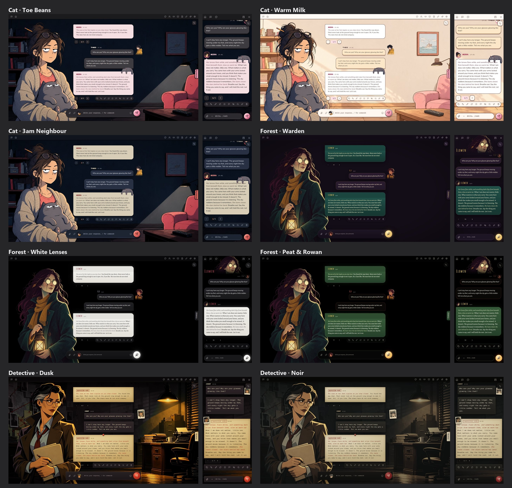
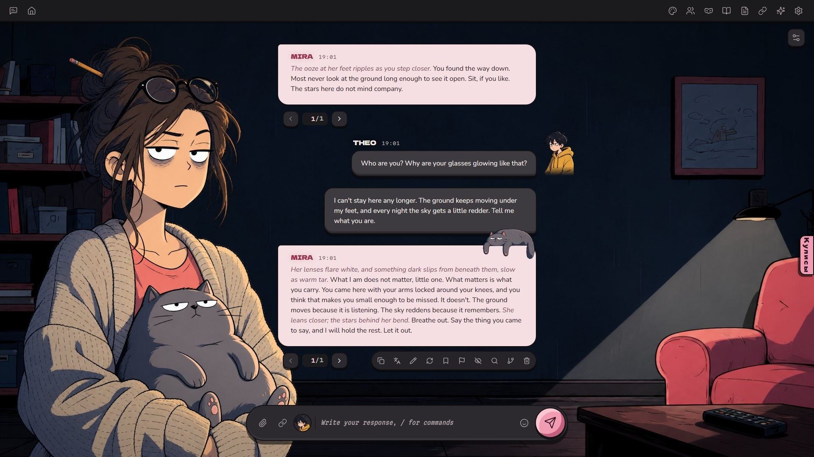
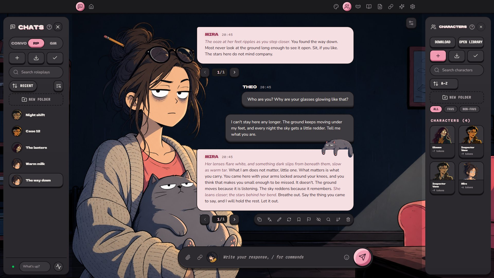
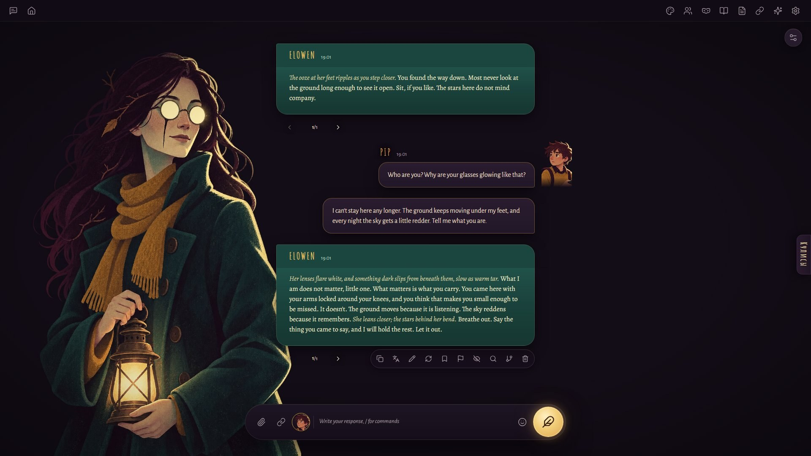
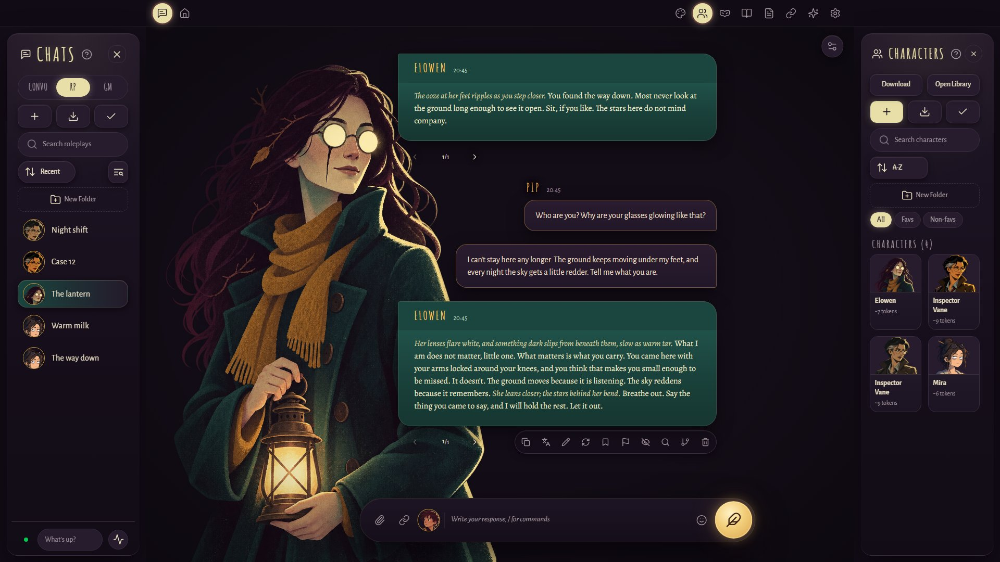
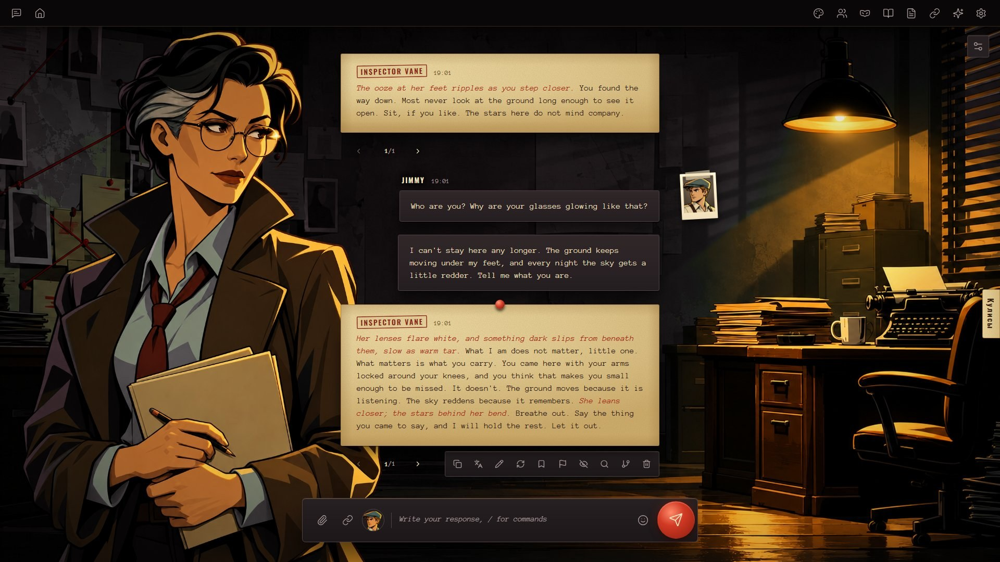
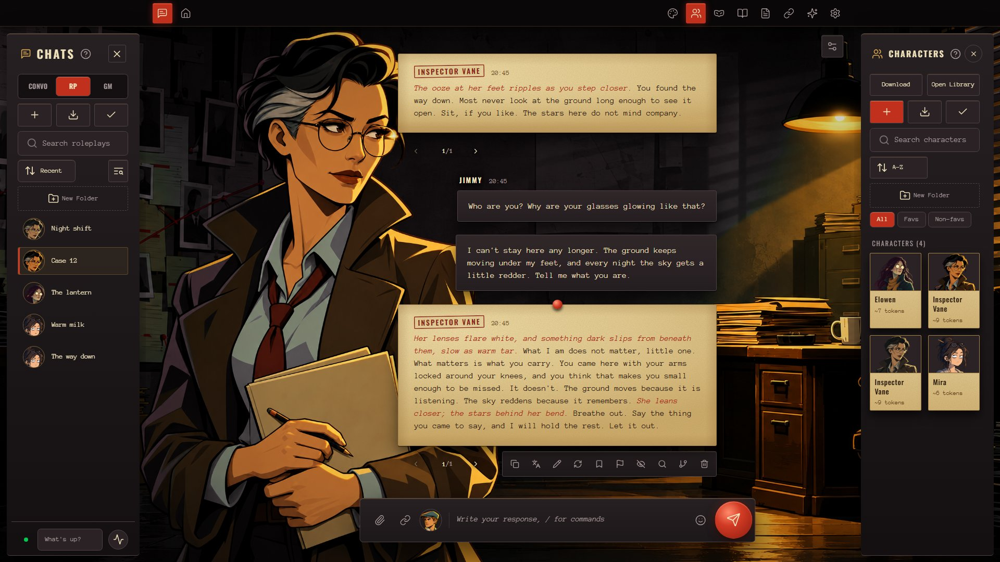

# Frontispiece - a theme for Marinara Engine

English · [Русский](README.ru.md)

The character's portrait stays in place while the messages scroll beside it, like the plate facing a book's title page.
Three styles - **Cat**, **Forest**, **Detective** - each in several colours. You pick the style and colour in the theme's card.

**How the portrait works:**
- In a group chat the portraits take turns: you see whoever's line you are reading. The change is a soft cross-fade, and only
  once scrolling stops.
- At the bottom of the chat you see whoever replied last; while a reply is being written, its writer.
- Narrator lines and your persona's lines don't change the portrait.
- Turn **Portrait follows scrolling** off in the theme's card, and the portrait always shows whoever replied last.
- With the Offstage extension installed, the portrait also changes its expression: the emotion you switch on in Offstage picks
  the sprite.

Needs Marinara Engine 2.5.0 or newer. Checked on desktop, iPad and iPhone.

| | |
|---|---|
|  |  |
|  |  |
|  |  |

## 1. Install

Marinara doesn't allow third-party extensions by default. You open this once.

1. In Marinara's folder, open the `.env` file and set `ENABLE_EXTERNAL_EXTENSIONS=true`. Save, wait a couple of seconds.
2. **Settings** (the gear at the top) → **Advanced** tab → **Danger Zone** → turn on **Allow third-party extension imports**
   → **I Understand, Enable**.
3. **Settings** → **Addons** → **External Extensions** → **Import Extension File** → pick
   `Frontispiece-1.0.0.personal-extension.zip` (from **Releases** on the right of this page).
4. On the theme's row, press the power button on the left (**Review and run**) → **Run Exact Code**.
5. Reload the page. The theme's button (a palette) appears in the top bar: style, colours and settings are there.

On a phone, **Settings**, **Characters** and **Personas** are in the **More** menu (top right).

## 2. Marinara settings the theme is made for

**Settings** → **Appearance** → **Roleplay** → **Roleplay Presentation**:
- **Chat position** - **Center** (the default). With Left or Right the theme dresses the messages but shows no portrait.
- **Scrollable Avatars** - on. Without it the persona picture breaks.
- **Roleplay Avatars** - **Glued Side Panel**. The theme is made for this one; the others work, but not as well.

**Settings** → **Appearance** → **Conversation** → **Chat Layout** - **Linear**. With **Bubbles** the theme leaves
Conversation mode as Marinara draws it.

Group chats: the round **Chat Settings** button in the chat → **Group Chat** → **Mode** - **Individual** (one speaker per
message). Otherwise the portrait doesn't change.

Message times: **Settings** → **Advanced** → **Message Tools** → **Show message timestamps**. The theme shows the time only
when this is on.

## 3. Portraits

The theme shows the character's sprites - the picture that fits the scene.

**The picture** (character and persona):
- upright, about **2:3** (around 1365 × 2048 is good);
- best as a **PNG with a transparent background**;
- the figure **down to the waist or lower**, the head in the upper third, a little air above it.

The examples archive has `avatar-template.png`, a transparent 2:3 overlay: lay it over your picture to check the framing.

**Sprites**: **Characters** → the character → **Sprites** tab → **Facial Expressions**. Type a name (`neutral` is the everyday
face) → **Upload** → pick the file. Or a whole folder at once: **Upload Folder**, each file name becomes the emotion
(`neutral.png`, `anger.png`, `shy.png`…). The Offstage extension picks the emotion if it is installed; without it the theme
shows `neutral`. With no sprites at all, the theme shows the character's avatar.

Emotion names Offstage uses: `anger`, `sadness`, `anxiety`, `fear`, `shy`, `tender`, `love`, `desire`, `playful`, `fun`,
`cold`, `suspicion`, `jealousy`, `hurt`, `guilt`, `cruel`, plus `neutral`. A sprite with any other name won't be picked up.

**Face square**: **Characters** → the character → **Metadata** → **Avatar** → **Avatar Crop**. Put the square around the head
and press **Save**. The round avatars (phone, iPad, Conversation, chat list) show this square, and so does the persona card on
desktop. For a persona the same: **Personas** → the persona → **Metadata** → **Avatar Crop**. Set the square after uploading
the avatar: a new avatar resets it.

## 4. Examples

`Frontispiece-examples.zip` (also in **Releases**):
- `characters` - the heroines from the previews (Cat, Forest, Detective, and Detective in Noir colours);
- `personas` - the player characters that go with them;
- `backgrounds` - the rooms;
- `avatar-template.png` - the framing template.

To set up a scene like the previews:
1. **Characters** → a new character → **Metadata** → **Upload avatar** - a picture from `characters`. Upload the same picture
   on the **Sprites** tab under the name `neutral`. Set the face square.
2. **Personas** → a new persona → **Upload avatar** - a picture from `personas`, then the face square.
3. Open the chat → **Settings** → **Appearance** → **App** → **Backgrounds** → **Chat Background** → **Browse library** →
   **Import Backgrounds** → a picture from `backgrounds`.
4. In the theme's card, turn **Default background** off (otherwise the theme paints its own plain colour, not the chat's picture).

## 5. Theme settings

The theme's button in the top bar (a palette):
- **Style** - Cat, Forest or Detective; **Colours** - the colours of that style. Each style remembers its last colour.
- **Portrait follows scrolling** - the portrait shows whoever you are reading. Off: whoever replied last.
- **My Marinara font in messages** - messages in your font from Marinara's settings.
- **Default background** - the theme's plain background. Off: the chat's own background.
- **Character replies in my colour** - the character's plates take your plates' colour.
- **My Marinara colours** - every colour comes from Marinara's settings.
- **Hide the cat / Hide the pin** - no mascot on the last reply (Cat and Detective).
- **Hide the portrait header** - Forest only, phone only: the plain bar instead of the character's head.

Settings are kept per browser: a phone and a computer each have their own.

## Licences

Code: MIT ([LICENSE](LICENSE)). Fonts: SIL Open Font License, their licence files are inside the theme's zip; the Forest
Send icon is from Lucide (ISC). The pictures in the previews and examples are AI-made examples and come with no licence.

Made by RadaOgrada.
